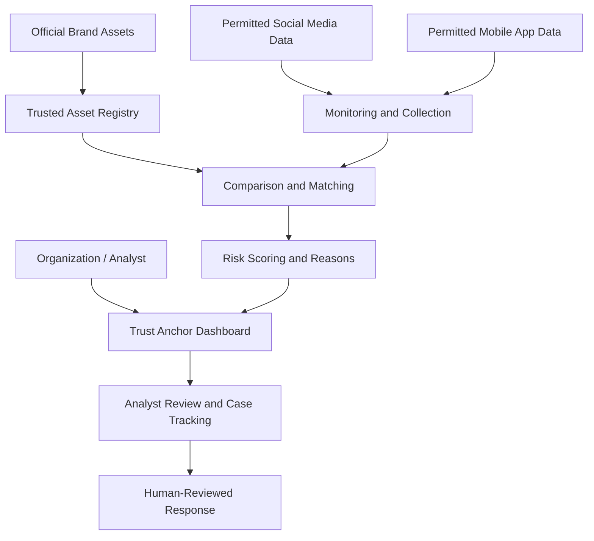

# 🛡️ Trust Anchor
### For Stability and Reliability

**A Digital Risk Protection platform focused on Social & App Monitoring.**

Trust Anchor aims to help organizations identify suspicious digital identities, review evidence, assess risk, and respond before customers or their brand are harmed.

  <a href="https://trust-anchor.netlify.app/"><strong>🌐 Live Website</strong></a> •
  <a href="https://github.com/srinivasaadityaram/Trust-Anchor"><strong>💻 GitHub Repository</strong></a> •
  <a href="docs/Trust_Anchor_Report.docx"><strong>📄 Project Report</strong></a>

---

## 📌 Table of Contents

- [Overview](#-overview)
- [Problem Statement](#-problem-statement)
- [Our Solution](#-our-solution)
- [Key Capabilities](#-key-capabilities)
- [How It Works](#-how-it-works)
- [System Architecture](#️-system-architecture)
- [Technology Stack](#️-technology-stack)
- [Live Demo](#-live-demo)
- [Project Report](#-project-report)
- [Future Scope](#-future-scope)
- [Responsible Use](#️-responsible-use)

## 🚀 Overview

Trust Anchor is a Digital Risk Protection platform focused on Social and App Monitoring. It is intended to help organizations discover possible impersonation across social profiles, brand pages, scam accounts, and mobile applications.

Organizations can register official brand information—such as company names, logos, domains, social handles, and mobile-app identifiers—and compare collected records with these trusted assets. Potentially suspicious matches can be flagged, assigned risk levels, and presented in a dashboard for investigation.

## ❗ Problem Statement

Organizations face digital risks from fake or impersonating social-media profiles, fake company or brand pages, scam accounts using a company’s identity, and suspicious mobile applications that impersonate a legitimate brand.

The main goal is to help organizations discover suspicious digital identities early, review evidence, assess risk, and respond before customers or the brand are harmed.

## 💡 Our Solution

Trust Anchor monitors permitted social-media and mobile-app data sources to identify accounts or applications that may be impersonating a legitimate company or brand.

The platform is designed to compare collected records with official brand assets, flag suspicious matches, assign risk levels, and present findings for analyst review.

## ✨ Key Capabilities

- **Social Profile & Page Monitoring:** Identify lookalike names, copied brand identity, and suspicious links.
- **Mobile Application Monitoring:** Review similar app names and icons, unknown publishers, and potentially misleading descriptions.
- **Risk Scoring:** Provide risk levels and reasons explaining why an item was flagged.
- **Analyst Dashboard:** Review evidence, mark false positives, assign cases, and track incidents.
- **Alerts & Reports:** Highlight high-risk findings, with human review before external reporting or takedown requests.

*These are the project's intended capabilities; availability depends on the current implementation and connected data sources.*

## ⚙️ How It Works

1. **Register trusted brand assets:** Add official company names, logos, domains, social handles, and mobile-app identifiers.
2. **Collect permitted records:** Use authorized social-media and mobile-app data sources.
3. **Compare records:** Check collected information against registered brand assets.
4. **Flag potential matches:** Identify similarities such as lookalike names, copied branding, suspicious links, or similar app icons.
5. **Assess risk:** Assign risk levels and show reasons for the flags.
6. **Review and respond:** Analysts examine evidence, mark false positives, track cases, and decide whether further action is appropriate.

Automated flags are risk indicators, not proof of wrongdoing. Findings should be verified by a human before reporting or requesting a takedown.

## 🏗️ System Architecture

The following is a high-level conceptual architecture based on the project report. It describes the intended workflow and does not claim that every component is already implemented.

### Architecture components

- **Trusted Asset Registry:** Stores official brand identifiers supplied by an organization.
- **Monitoring and Collection:** Uses permitted data sources for social profiles, pages, and mobile applications.
- **Comparison and Matching:** Compares collected records with registered brand assets.
- **Risk Scoring:** Assigns risk levels and explains why a record was flagged.
- **Dashboard and Case Review:** Presents evidence for analyst review and incident tracking.
- **Human-Reviewed Response:** Supports careful decisions before external reporting or takedown requests.

## 🛠️ Technology Stack

The exact technology stack should match the dependencies and configuration in the repository. Refer to the project source code and configuration files for confirmed implementation details.

## 🌐 Live Demo

- **Live website:** [https://trust-anchor.netlify.app/](https://trust-anchor.netlify.app/)
- **Project repository:** [https://github.com/srinivasaadityaram/Trust-Anchor](https://github.com/srinivasaadityaram/Trust-Anchor)

## 📄 Project Report

The accompanying report contains the project problem statement, proposed solution, key capabilities, system reference diagram, and future scope.

**[Open the Trust Anchor Project Report](docs/Trust_Anchor_Report.docx)**

The report is included in this repository package at `docs/Trust_Anchor_Report.docx`.

## 🔮 Future Scope

- Expand monitoring to additional social networks and app stores where authorized access is available.
- Add AI-based logo and image matching to detect copied brand visuals.
- Support multiple languages and regional scam patterns.
- Analyze suspicious URLs, domains, developer identities, and linked accounts to identify coordinated campaigns.
- Add real-time or more frequent alerts through email, collaboration tools, or security platforms.
- Integrate with SIEM/SOAR tools and organizational incident-management workflows.
- Improve risk scoring using analyst feedback and measured false-positive rates.
- Add enterprise features such as single sign-on, granular access controls, audit exports, configurable retention, and multi-organization support.
- Add trend reports showing impersonation attempts, recurring tactics, and time-to-resolution.

## ⚖️ Responsible Use

- Use authorized and permitted data sources.
- Respect privacy, applicable laws, and platform terms.
- Treat automated findings as potential indicators and verify evidence before taking action.
- Require human review before external reporting or takedown requests.
- Protect API keys, credentials, and sensitive investigation data.

---

  <strong>🛡️ Trust Anchor — For Stability and Reliability</strong>
   
  Helping organizations investigate potential digital impersonation.

